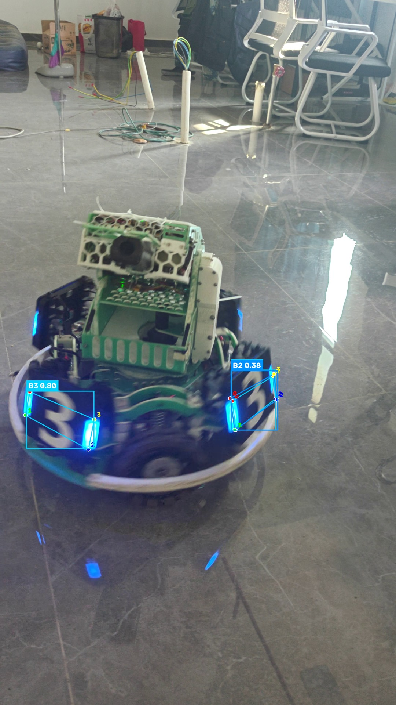
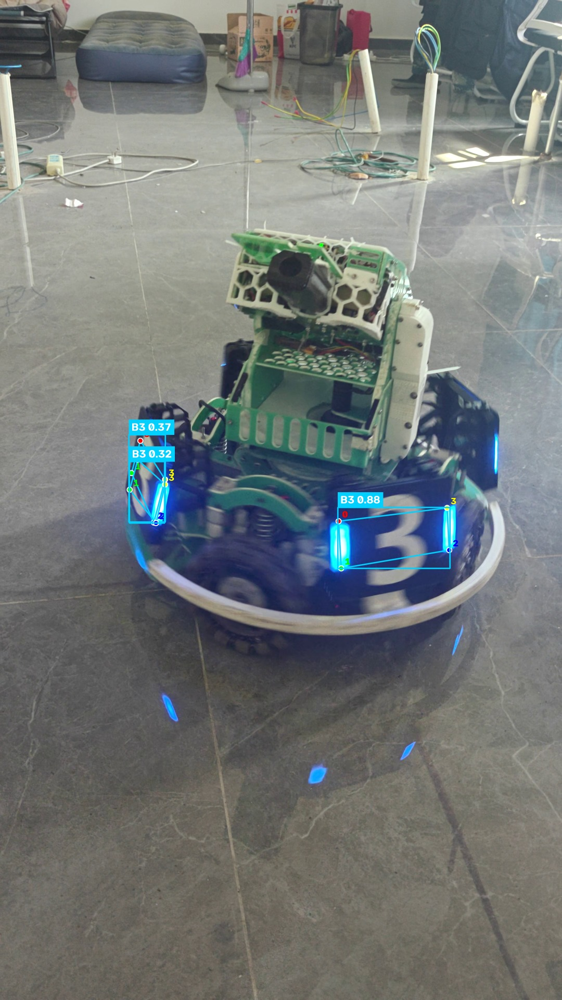
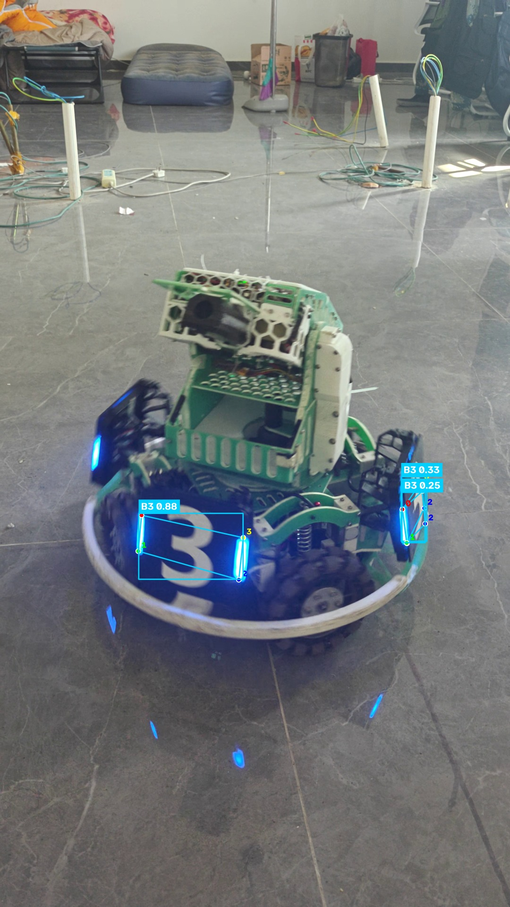

# 装甲板检测与四角点可视化（YOLO26n）

使用课程统一下发的 **YOLO26n 装甲板四角点模型** `best.pt`，对本人自行拍摄的
RoboMaster 装甲板视频逐帧推理，输出带 **检测框、类别、置信度** 和
**模型预测的 4 个关键点** 的结果视频与统计信息。

---

## 1. 完成的功能

推理脚本 [`infer.py`](infer.py) 主要完成：

1. 加载模型权重 `best.pt`，读取自行拍摄的装甲板视频；
2. 对视频逐帧执行推理（YOLO26n-pose，输出检测框 + 4 个二维关键点）；
3. 对检测到的每个目标绘制：
   - 检测框（蓝方 B1/B2/B3 用蓝色系，红方 R1/R2/R3 用红色系）；
   - 类别名称与置信度，例如 `B3 0.80`；
   - **该目标的 4 个关键点**：直接取自模型的 `result.keypoints` 预测结果
     （**不是**用检测框的四个角代替）。四个点使用不同颜色并标注序号 `0~3`，
     同时按预测顺序连成四边形，便于看出关键点属于哪一个目标；
4. 保存与原视频内容一一对应、可正常播放的结果视频；
5. 输出统计信息 JSON（处理帧数、含目标帧率、各类别数量与平均置信度、耗时与 FPS）；
6. 自动挑选并保存若干张代表性结果截图，用于报告展示。

关键点数据来源（[`infer.py`](infer.py) 中的核心逻辑）：

```python
result = model.predict(frame, imgsz=960, conf=0.25, device=device)[0]
kxy = result.keypoints.xy.cpu().numpy()   # 形状 (N, 4, 2)，即每个目标的 4 个角点
```

---

## 2. 运行环境

| 项目 | 说明 |
| --- | --- |
| 操作系统 | Windows 11（代码同样适用于 Linux / macOS） |
| Python | **3.14.7** |
| 推理框架 | Ultralytics **8.4.176** |
| 深度学习框架 | PyTorch **2.11.0+cu128**、Torchvision **0.26.0+cu128** |
| 图像处理 / 数值计算 | OpenCV **5.0.0.93**、NumPy **2.5.4** |
| 推理设备 | **GPU：NVIDIA GeForce RTX 5060 Laptop（8 GB）**；脚本同时支持 `--device cpu` |

> 说明：PyPI 上 Windows 平台的 `torch` 默认是 CPU 版本（`2.x.x+cpu`）。
> 需要 GPU 推理时，请按第 5 节先安装 CUDA 版 PyTorch。

---

## 3. 模型权重的准备方式与放置位置

模型权重由课程"参考材料"统一下发，**不纳入 Git 版本管理**
（`.gitignore` 中已排除 `*.pt`）。

准备步骤：

1. 从课程参考材料下载 `best.pt`；
2. 在仓库根目录创建 `weights/` 目录，把 `best.pt` 放进去：

```
yolo-armor-inference/
└── weights/
    └── best.pt        <-- 放置模型权重
```

3. 模型信息（脚本运行时自动打印）：

| 项目 | 值 |
| --- | --- |
| 任务类型 | `pose`（检测 + 关键点） |
| 类别 | `B1, B2, B3, R1, R2, R3`（蓝方 3 类、红方 3 类，共 6 类） |
| 关键点形状 | `[4, 2]`，即每个目标输出 4 个关键点的 (x, y) 坐标 |

权重路径可通过参数修改：`--weights <路径>`。

---

## 4. 视频素材（拍摄说明）

| 项目 | 说明 |
| --- | --- |
| 拍摄地点 | 水建学院 **D414 实验室** |
| 拍摄设备 | 手机 |
| 分辨率 / 帧率 | 2160 × 3840（4K 竖屏）@ 60.011 fps |
| 时长 | **10.41 秒**（625 帧） |
| 原始文件 | MP4，70.2 MB |

**场景说明**：画面主体为实验室地面上的 RoboMaster 步兵机器人，其正面与侧面各
安装一块编号为 **3** 的蓝方装甲板（带蓝色灯条）。拍摄过程中镜头由远及近缓慢
推进，并伴随轻微的俯仰与角度变化，用于观察模型在**不同距离、不同角度**下的
识别表现。

原始视频不纳入 Git 版本管理（`.gitignore` 已排除 `assets/` 下的视频文件）。
运行前请把自行拍摄的视频放入 `assets/` 目录，或用 `--source <路径>` 指定。

---

## 5. 依赖安装步骤

```bash
# 1) 创建并激活虚拟环境（虚拟环境不纳入 Git）
python -m venv .venv
.venv\Scripts\activate            # Windows
# source .venv/bin/activate       # Linux / macOS

# 2) 安装依赖
pip install -r requirements.txt
```

**如需 GPU 加速**（本机实测配置），先安装 CUDA 版 PyTorch，再安装其余依赖：

```bash
pip install torch torchvision --index-url https://download.pytorch.org/whl/cu128
pip install -r requirements.txt
```

安装完成后自检：

```bash
python -c "import torch; print(torch.__version__, torch.cuda.is_available())"
```

---

## 6. 实际运行命令与结果保存位置

```bash
# 使用默认路径（weights/best.pt + assets/armor_raw.mp4）
python infer.py

# 显式指定权重、输入视频、输出位置与推理设备
python infer.py --weights weights/best.pt --source assets/armor_raw.mp4 \
    --output results/armor_result.mp4 --device 0 --imgsz 960 --conf 0.25

# 使用 CPU 推理
python infer.py --device cpu
```

主要参数（`python infer.py --help` 可查看完整列表）：

| 参数 | 默认值 | 说明 |
| --- | --- | --- |
| `--weights` | `weights/best.pt` | 模型权重路径 |
| `--source` | `assets/armor_raw.mp4` | 输入视频路径 |
| `--output` | `results/armor_result.mp4` | 结果视频保存路径 |
| `--stats` | `results/inference_stats.json` | 统计信息保存路径 |
| `--frames-dir` | `docs` | 代表性截图保存目录 |
| `--device` | `auto` | `auto` / `0`（GPU）/ `cpu` |
| `--imgsz` | `960` | 推理输入尺寸 |
| `--conf` / `--iou` | `0.25` / `0.7` | 置信度阈值 / NMS IoU 阈值 |

**结果保存位置**：

```
results/
├── armor_result.mp4          # 结果视频（2160×3840，H.264，10.41 s，约 30 MB）
└── inference_stats.json      # 推理统计信息
docs/
└── sample_*.jpg              # 代表性结果截图
```

结果视频通过 ffmpeg 编码为 **H.264 / yuv420p**，可直接用系统播放器或浏览器
播放；若环境中没有 ffmpeg，脚本会自动回退到 OpenCV 的 `mp4v` 编码。

---

## 7. 实际识别表现

### 7.1 总体结果

| 指标 | 数值 |
| --- | --- |
| 处理帧数 | 625 / 625 |
| 含检测目标的帧数 | 625（100%） |
| 目标总数 | 913 |
| 平均置信度 | 0.766 |
| 推理参数 | `imgsz=960, conf=0.25, iou=0.7` |
| 端到端耗时 | GPU 92.9 s（6.72 FPS）／ CPU 96.1 s（6.50 FPS） |

按类别统计（GPU 与 CPU 两次运行结果完全一致）：

| 类别 | 数量 | 平均置信度 | 说明 |
| --- | --- | --- | --- |
| **B3** | 909 | 0.768 | 正确类别：画面中蓝方 3 号装甲板 |
| B2 | 4 | 0.339 | **误检**（见 7.5） |

### 7.2 典型结果截图

正面装甲板稳定检出，检测框、类别、置信度与 4 个关键点均正确显示
（每个关键点用不同颜色绘制并标注序号 0~3，四点连成四边形以体现归属）：



不同距离下的识别表现：





### 7.3 关键点确实来自模型预测（不是检测框的四个角）

以第 600 帧检出的目标为例，把检测框与模型输出的关键点坐标放在一起对比：

| 项目 | 坐标 |
| --- | --- |
| 检测框 (x1, y1, x2, y2) | (979.7, 1991.5, 1422.5, 2217.7) |
| 关键点 0 | (999.8, 1993.9) |
| 关键点 1 | (978.1, 2141.3) |
| 关键点 2 | (1400.1, 2219.7) |
| 关键点 3 | (1423.2, 2051.0) |

如果使用检测框的四个角代替，坐标应当是 (979.7, 1991.5)、(1422.5, 1991.5)、
(1422.5, 2217.7)、(979.7, 2217.7)，与上表 4 个关键点**均不相同**，
可见关键点确实取自模型的 `result.keypoints` 预测结果。

### 7.4 耗时分析：瓶颈在视频编解码，而不是模型推理

实测 60 帧的平均单帧耗时（输入 2160×3840 @ 60 fps）：

| 阶段 | 单帧耗时 | 等效 FPS |
| --- | --- | --- |
| 模型推理（GPU，`imgsz=960`） | 14.0 ms | 71.3 |
| 模型推理（CPU，`imgsz=960`） | 34.6 ms | 28.9 |
| 4K H.264 视频解码 | 57.4 ms | 17.4 |
| 结果视频编码（libx264 veryfast） | 32.1 ms | 31.1 |

GPU 让推理环节比 CPU 快约 2.5 倍（14.0 ms vs 34.6 ms），但整条流水线中最慢的
是 4K 视频解码（57.4 ms/帧）与结果视频编码（32.1 ms/帧），因此**端到端耗时
GPU 与 CPU 接近**（92.9 s vs 96.1 s）。这说明本作业的耗时瓶颈是 4K 视频的
读写与渲染，而不是模型本身；若降低输入/输出分辨率，整体速度会明显提升。

### 7.5 遇到的问题与处理方法

1. **类别误判（侧面装甲板被识别为 B2）**
   画面右侧那块装甲板实际编号同为 **3**，但在较大的侧视角度下被识别为
   `B2`，置信度仅 **0.38**。
   *原因*：侧视造成装甲板严重透视压缩，数字"3"的形状特征不完整。
   *处理*：保留原始结果未做任何修改；由于该误检置信度（0.34）远低于正确
   检测（0.77），可通过提高置信度阈值（例如 `--conf 0.5`）过滤掉这类低
   置信度误检。

2. **同一块装甲板的漏检**
   全片共检出 913 个目标（平均 1.46 个/帧），说明并非每一帧都能同时检出
   正面与侧面两块装甲板：侧面那块在极端角度下会被漏检。
   *处理*：属于模型在该视角下的能力边界，如实记录；若需要更稳定的侧视角
   识别，需要补充对应角度的训练数据。

3. **关键点位置偏差**
   模型输出的 `kpt_shape` 为 `[4, 2]`，**不包含关键点置信度**，因此无法
   直接按置信度过滤质量较差的关键点。在正对镜头时 4 个关键点能准确贴合
   装甲板四角；在斜视角下会出现少量偏移。脚本对预测出的关键点全部绘制，
   以保证结果真实。

4. **首次运行的配置目录问题（排查过程）**
   首次运行脚本时出现报错：

   ```
   PermissionError: [WinError 5] 拒绝访问: 'C:\Users\...\AppData\Roaming\Ultralytics'
   ```

   排查过程：确认模型权重路径、视频路径与推理参数均正确后，判断该报错与
   推理本身无关，而是 Ultralytics 需要写用户级配置目录失败。
   *处理*：设置环境变量 `YOLO_CONFIG_DIR` 指向可写目录后正常运行：

   ```bash
   set YOLO_CONFIG_DIR=D:\path\to\project     # Windows
   export YOLO_CONFIG_DIR=/path/to/project    # Linux / macOS
   ```

---

## 8. 仓库结构

```
yolo-armor-inference/
├── infer.py                  # 推理与可视化脚本
├── requirements.txt          # 依赖说明
├── README.md                 # 本文件
├── .gitignore                # 排除权重、视频、虚拟环境等
├── weights/                  # 模型权重（自行放置 best.pt，不入库）
├── assets/                   # 原始视频（自行放置，不入库）
├── results/                  # 结果视频与统计（运行后生成，不入库）
└── docs/                     # 代表性结果截图（入库）
```
